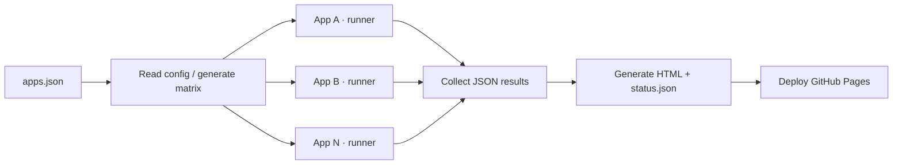

# Pulse · Monitoring pipeline

**A JSON config becomes parallel health checks and a public status dashboard.** Each application gets its own GitHub Actions job and hosted runner. Every monitoring run replaces the dashboard with the latest results.

[Live dashboard](https://ivangergo3.github.io/monitoring-pipeline/) · [Run monitoring](https://github.com/ivangergo3/monitoring-pipeline/actions/workflows/monitor.yml) · [Tests](https://github.com/ivangergo3/monitoring-pipeline/actions/workflows/test.yml)

## How it works



- **Dynamic matrix:** adding an application requires only a config change.
- **Independent checks:** `fail-fast: false` keeps other checks running if a runner fails.
- **Failure-aware reporting:** HTTP errors and timeouts become unhealthy results; missing runner results become unknown. The publishing job runs even if a check job fails.
- **Latest snapshot:** no application history or database. GitHub retains workflow logs; intermediate artifacts expire after one day.
- **Static dashboard:** responsive HTML, no JavaScript, no external assets. The page refreshes every 60 seconds to pick up the latest published snapshot. This does not trigger new checks.
- **Minimal permissions:** check jobs can read the repo; only the publishing job can deploy Pages.
- **No dependencies:** Python 3.10+ standard library; no API keys or paid infrastructure.

## Run it

Open **Actions → Monitor and publish → Run workflow**, and select `main`. When deployment completes, the dashboard and [`status.json`](https://ivangergo3.github.io/monitoring-pipeline/status.json) update at the same stable URL. Do not run monitoring from an untrusted branch.

Monitoring is manual only. In `.github/workflows/monitor.yml`, uncomment the `schedule` block to enable hourly checks at minute 17 UTC. GitHub schedules can be delayed. Whole-run concurrency prevents overlapping deployments; GitHub can replace pending queued runs with a newer one.

An unhealthy app is a successful monitoring observation, so it does **not** make the workflow fail. Runner, script, and deployment failures still fail their jobs. Cancelled runs leave the previous dashboard published. Config validation failure prevents deployment rather than publishing an invalid app list.

## Add an application

Edit `apps.json`:

```json
{
  "title": "Application health",
  "applications": [
    {
      "id": "my-api",
      "name": "My API",
      "url": "https://example.com/health",
      "expected_status": 200,
      "timeout_seconds": 10
    }
  ]
}
```

`id`, `name`, and `url` are required. IDs must be unique lowercase letters, numbers, or hyphens, starting with a letter or number, up to 63 characters. `expected_status` defaults to 200; `timeout_seconds` defaults to 10 and must be greater than zero and at most 60. Up to 256 apps are supported by the matrix; actual parallelism depends on GitHub's runner limits.

The probe sends an HTTP GET, follows redirects, and compares the final response code with the expected code. Response time measures time to response headers, including connection setup and redirects; it does not download the response body. The timeout applies to blocking network operations, not a strict total duration budget. There is one attempt per run, with no retries or response-body validation.

This is a public showcase: configured URLs and results are public. Add only public, non-sensitive URLs. Future authenticated checks should read credentials from GitHub Secrets and avoid publishing secrets in URLs or errors.

## Demo endpoints

The initial config uses [JSONPlaceholder](https://jsonplaceholder.typicode.com/) and [httpbin](https://httpbin.org/): a sample API, a 200 response, a one-second delay, and a deliberate 503 outage. **Outage demo is expected to appear unhealthy.** These are third-party testing services; their real availability and latency may vary. The page reports actual observations rather than hardcoded statuses.

## Local development

```sh
python3 -m unittest discover -s tests -v
python3 scripts/monitor.py matrix
python3 scripts/monitor.py local
python3 -m http.server 8000 --directory dist
```

Open <http://localhost:8000>. Local checks run sequentially; GitHub runs each app on its own runner. Generated `results/` and `dist/` folders are ignored by Git. To check just one app, use `python3 scripts/monitor.py check --app demo-api`. To render existing results, use `python3 scripts/monitor.py build`.

Tests use a local HTTP server to verify healthy responses, HTTP failures, custom status codes, redirects, timeouts, connection errors, missing or corrupt results, HTML escaping, and config validation. They do not depend on external demo services.

## Fork and deploy

1. Fork or clone this repository into a public GitHub repository.
2. Set **Settings → Pages → Build and deployment → Source** to **GitHub Actions**.
3. Update the links in this README for your owner and repository name.
4. Run **Monitor and publish** from `main`.

See GitHub's [custom Pages workflows](https://docs.github.com/en/pages/getting-started-with-github-pages/using-custom-workflows-with-github-pages) documentation. The site uses relative links and works under a repository Pages URL without changes to the template.

## License

MIT
