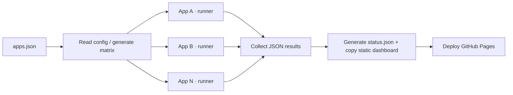

# Pulse · Monitoring pipeline

**A JSON config becomes parallel health checks and a public status dashboard.** Each application gets its own GitHub Actions job and hosted runner. Every monitoring run replaces the dashboard with the latest results.

[Live dashboard](https://ivangergo3.github.io/monitoring-pipeline/) · [Run monitoring](https://github.com/ivangergo3/monitoring-pipeline/actions/workflows/monitor.yml) · [Tests](https://github.com/ivangergo3/monitoring-pipeline/actions/workflows/test.yml)

## How it works



- **Dynamic matrix:** adding an application requires only a config change.
- **Independent checks:** `fail-fast: false` keeps other checks running if a runner fails.
- **Failure-aware reporting:** HTTP errors and timeouts become unhealthy results; missing runner results become unknown. The publishing job runs even if a check job fails.
- **Latest snapshot:** no application history or database. GitHub retains workflow logs; intermediate artifacts expire after one day.
- **Reusable dashboard:** HTML and a small dependency-free JavaScript module stay identical between monitoring runs. The browser fetches only `status.json` every 60 seconds without reloading the page. Fetches bypass browser caching and use a timestamp query to avoid reusing an older cached JSON response. Failed refreshes retain the last loaded snapshot with a visible warning. JavaScript is required for the visual dashboard; the raw JSON remains directly accessible.
- **Minimal permissions:** check jobs can read the repo; only the publishing job can deploy Pages.
- **Bash monitoring:** Bash 3.2+, `curl`, and `jq` 1.6+; no API keys or paid infrastructure. These tools are preinstalled on the hosted Ubuntu runners. Node.js 18+ is used only for frontend tests and the local HTTP test fixture.

## Publishing efficiency

The publishing job uses sparse checkout to fetch only `apps.json`, `scripts/`, and `site/`, with checkout credential persistence disabled. Only `status.json` is generated from each run; the HTML and JavaScript are copied unchanged. **GitHub Pages still requires a complete site artifact on every deployment**: uploading JSON alone would replace the site and remove its dashboard. There is no cache restoration or remote download of the shell. This reduces unnecessary work but does not remove runner scheduling or Pages deployment latency; savings for a small repository may be modest.

## Run it

Open **Actions → Monitor and publish → Run workflow**, and select `main`. When deployment completes, the dashboard and [`status.json`](https://ivangergo3.github.io/monitoring-pipeline/status.json) update at the same stable URL. Do not run monitoring from an untrusted branch.

Monitoring runs manually or when the config, checker, template, or monitoring workflow changes on `main`. In `.github/workflows/monitor.yml`, uncomment the `schedule` block to enable hourly checks at minute 17 UTC. GitHub schedules can be delayed. Whole-run concurrency prevents overlapping deployments; GitHub can replace pending queued runs with a newer one.

An unhealthy app is a successful monitoring observation, so it does **not** make the workflow fail. Runner, script, and deployment failures still fail their jobs. Cancelled runs leave the previous dashboard published. Config validation failure prevents deployment rather than publishing an invalid app list.

Reruns are supported: each Pages bundle includes `github.run_attempt` in its name, and deployment explicitly selects that attempt's bundle. Per-app result uploads use `overwrite: true` so a rerun replaces that app's artifact. Stable per-app names also let a publishing-only rerun reuse the existing check results and partial check reruns retain results from other apps. Artifacts must still be available within their one-day retention period; start a fresh workflow run if they have expired.

## Add an application

Edit `apps.json`:

```json
{
  "title": "Application health",
  "applications": [
    {
      "id": "my-api",
      "name": "My API",
      "url": "https://example.com/health",
      "expected_status": 200,
      "timeout_seconds": 10
    }
  ]
}
```

`id`, `name`, and `url` are required. IDs must be unique lowercase letters, numbers, or hyphens, starting with a letter or number, up to 63 characters. `expected_status` defaults to 200; `timeout_seconds` defaults to 10 and must be greater than zero and at most 60. Up to 256 apps are supported by the matrix; actual parallelism depends on GitHub's runner limits.

The probe sends an HTTP GET, follows redirects, and compares the final response code with the expected code. Response time measures the complete HTTP transfer, including connection setup, redirects, and the response body, which is discarded. `timeout_seconds` is a total request budget, enforced by curl across the transfer. Redirects are limited to 10 and restricted to HTTP(S). A timeout after HTTP 200 headers still counts as unhealthy. There is one attempt per run, with no retries or response-body validation.

This is a public showcase: configured URLs and results are public. Add only public, non-sensitive URLs. Future authenticated checks should read credentials from GitHub Secrets and avoid publishing secrets in URLs or errors.

## Demo endpoints

The initial config uses [JSONPlaceholder](https://jsonplaceholder.typicode.com/) and [httpbin](https://httpbin.org/): a sample API, a 200 response, a one-second delay, and a deliberate 503 outage. **Outage demo is expected to appear unhealthy.** These are third-party testing services; their real availability and latency may vary. The page reports actual observations rather than hardcoded statuses.

## Local development

```sh
bash tests/run.sh
bash scripts/monitor.sh matrix
bash scripts/monitor.sh local
# Serve dist/ with any static HTTP server to preview it in a browser.
```

Serve the generated `dist/` directory over HTTP (opening the HTML directly as a file does not support JSON fetching). Local checks run sequentially; GitHub runs each app on its own runner. Generated `results/` and `dist/` folders are ignored by Git. To check just one app, use `bash scripts/monitor.sh check --app demo-api`. To render existing results, use `bash scripts/monitor.sh build`.

Bash tests exercise the actual CLI and curl against a temporary local Node.js HTTP fixture. They cover healthy responses, HTTP failures, custom status codes, redirects, header/body timeouts, connection errors, missing or corrupt results, an unchanged dashboard shell across result updates, and config validation. No monitoring code or Bash test assertions require Python. CI also checks shell syntax and runs ShellCheck. Frontend tests cover URL validation, invalid snapshots, refresh failures, and recovery; dynamic text is rendered with DOM text nodes rather than HTML interpolation. They do not depend on external demo services.

## Fork and deploy

1. Fork or clone this repository into a public GitHub repository.
2. Set **Settings → Pages → Build and deployment → Source** to **GitHub Actions**.
3. Update the links in this README for your owner and repository name.
4. Run **Monitor and publish** from `main`.

See GitHub's [custom Pages workflows](https://docs.github.com/en/pages/getting-started-with-github-pages/using-custom-workflows-with-github-pages) documentation. The site uses relative links and works under a repository Pages URL without changes to the template.

## License

MIT
